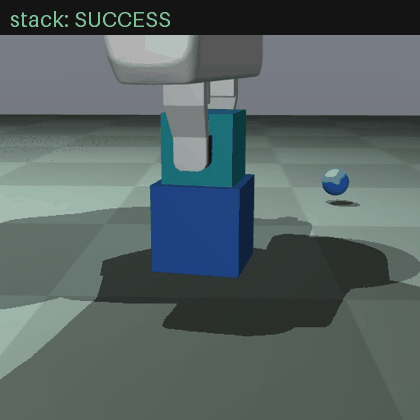
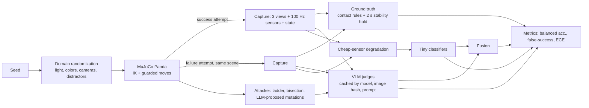

# Vision Can't Feel

A benchmark of minimal pairs that tests whether free vision-language models can judge contact-dependent robot success, and how a tiny classifier on cheap, noisy sensors compares.



**Website:** SITE_URL (play "Can you tell?", browse pairs, 3D scenes) · **Dataset:** DATASET_URL · **Report:** [report/report.pdf](report/report.pdf)

## Headline

HEADLINE

## Leaderboard

LEADERBOARD

Full tables, per-task breakdowns, calibration and noise sweeps: [results/large/leaderboard.md](results/large/leaderboard.md) and [results/small/leaderboard.md](results/small/leaderboard.md).

## What this is

- **Five contact tasks** in MuJoCo with a Franka Panda: stack (touching vs hovering), grasp (closed on vs beside), button (pressed past the click vs not), peg (seated vs on the rim), push (against the wall vs short of it).
- **Minimal pairs**: the same randomized scene captured as a success and as a failure a few millimeters off. Pixel differences between the pair are recorded.
- **Ground truth** from explicit contact and geometry rules on simulator state, after a 2 second stability hold.
- **Cheap sensors**: fingertip contact switch, gripper effort (a motor-current proxy), single-axis wrist force, degraded with noise, 8 to 10 bit quantization, drift, latency and dropouts. Strength is a parameter.
- **Judges**: free VLMs (Gemini and Gemma through AI Studio, Qwen through Groq, Qwen2.5-VL and Moondream locally through Ollama), single and multi-view; sensor-only logistic regression and gradient boosting; and a fusion of both.
- **Attacker**: finds the largest physical failure, in millimeters, that a VLM still calls a success, then checks whether those scenes fool other models and the sensor classifier.

## Architecture



## Reproduce

```bash
pip install -r requirements.txt
cp .env.example .env    # add free GEMINI_API_KEY and GROQ_API_KEY; install Ollama for local models
sh reproduce.sh
```

`reproduce.sh` fetches the robot model, regenerates every dataset split from its seed, runs every judge, evaluates, runs the attacker and exports the website data. Model answers are cached in `cache/`, so reruns cost nothing. A fresh run spans several days on free tiers: rerun the script and it continues where it stopped.

## Limitations

- Simulation only. Nothing is validated on hardware, and simulated touch and force are cleaner than real sensors even after degradation.
- Failures are synthetic, from five tasks designed for this study. The sensor classifiers do not transfer to unseen tasks (leave-one-task-out is near chance).
- The single-axis wrist force cannot see a sideways push, so the sensor classifier is weak on the push task.
- Minimal pairs are hard by construction. VLM accuracy here says little about natural failure distributions.
- Free-tier quotas limited how many samples some models judged. Every table shows coverage, and metrics use only answered samples.
- Local models ran on 384 px images on a CPU laptop.
- VLM confidence is self-reported text, not a probability.
- The vision-side finding is not new: FailBench reported VLMs near chance on contact-rich tasks in real data. See [RELATED_WORK.md](RELATED_WORK.md).

## License

Code: MIT. Dataset: CC BY 4.0. Robot model: MuJoCo Menagerie Franka Panda (Apache-2.0).
