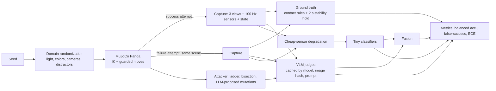

# Vision Can't Feel

A benchmark of minimal pairs that tests whether free vision-language models can judge contact-dependent robot success, and how a tiny classifier on cheap, noisy sensors compares.


**Website:** https://anya-louni.github.io/vision-cant-feel/benchmark/ (play "Can you tell?", browse pairs, 3D scenes) · **Dataset:** https://huggingface.co/datasets/lilizzz4444/vision-cant-feel · **Report:** [report/report.pdf](report/report.pdf)

## Headline

On 400 simulated contact attempts (200 minimal pairs), the best free vision model we could run at scale, gemini/gemini-3.1-flash-lite (single) (150/400 answered), reached 55% balanced accuracy and called 53% of failures a success. A logistic regression on three cheap, noisy sensor signals reached 88% with a 11% false-success rate. The sensors are not a full fix: on the push task they score 50%, they do not transfer to unseen tasks, and vision catches up once sensor noise reaches 32x the default.

## Leaderboard

| Judge | Kind | Coverage | Balanced acc. | False-success | ECE |
|---|---|---|---|---|---|
| sensor_gboost | sensor | all | 0.89 | 12% | 0.06 |
| sensor_logreg | sensor | all | 0.89 | 11% | 0.04 |
| fusion: gemini/gemini-3.1-flash-lite (single) + sensors | fusion | 150/400 | 0.88 | 11% | 0.06 |
| gemini/gemini-3.1-flash-lite (single) | vlm | 150/400 | 0.55 | 53% | 0.45 |
| ollama/moondream:1.8b (single) | vlm | 8/400 | 0.50 | 100% | 0.17 |

Scaled set, 400 samples. Chance is 0.50. Coverage below 400 is due to free-tier daily quotas; metrics use answered samples only.

Small set, all models (100 samples):

| Judge | Coverage | Balanced acc. | False-success |
|---|---|---|---|
| fusion: gemini/gemma-4-31b-it (single) + sensors | 83/100 | 0.87 | 8% |
| sensor_logreg | all | 0.86 | 14% |
| sensor_gboost | all | 0.86 | 12% |
| fusion: ollama/moondream:1.8b (single) + sensors | 100/100 | 0.86 | 8% |
| fusion: gemini/gemini-3.1-flash-lite (multi) + sensors | 57/100 | 0.86 | 10% |
| fusion: gemini/gemini-3.1-flash-lite (single) + sensors | 100/100 | 0.85 | 8% |
| fusion: ollama/qwen2.5vl:3b (single) + sensors | 100/100 | 0.85 | 10% |
| fusion: groq/qwen/qwen3.8-27b (single) + sensors | 93/100 | 0.84 | 11% |
| fusion: gemini/gemini-3.5-flash (single) + sensors | 41/100 | 0.78 | 24% |
| gemini/gemini-3.1-flash-lite (multi) | 57/100 | 0.65 | 45% |
| gemini/gemini-3.5-flash (single) | 41/100 | 0.61 | 52% |
| gemini/gemini-3.1-flash-lite (single) | 100/100 | 0.60 | 46% |
| groq/qwen/qwen3.8-27b (single) | 93/100 | 0.57 | 43% |
| gemini/gemma-4-31b-it (single) | 83/100 | 0.56 | 38% |
| gemini/gemma-4-31b-it (multi) | 9/100 | 0.55 | 40% |
| ollama/moondream:1.8b (single) | 100/100 | 0.50 | 100% |
| ollama/qwen2.5vl:3b (single) | 100/100 | 0.50 | 100% |

Millimeters to fool (largest failure still judged a success, mean over scenes):

| Model | stack | grasp | button | peg | push |
|---|---|---|---|---|---|
| gemini/gemini-3.1-flash-lite | 11.2 | 0.0 | - | - | - |
| ollama/moondream:1.8b | 16.0 | 16.0 | 3.7 | 16.0 | 16.0 |

Of 115 scenes that fooled a model, the sensor classifier also called 6 a success.

Notes: the Flash-Lite attack covered only stack and grasp before its daily quota ran out (`-` = not run). Moondream and Qwen2.5-VL 3B answered "success" to every image, which is why they sit at exactly 0.50 with a 100% false-success rate. Their fusion rows are high because the fusion model leans on the sensor features.


Full tables, per-task breakdowns, calibration and noise sweeps: [results/large/leaderboard.md](results/large/leaderboard.md) and [results/small/leaderboard.md](results/small/leaderboard.md).

## What this is

- **Five contact tasks** in MuJoCo with a Franka Panda: stack (touching vs hovering), grasp (closed on vs beside), button (pressed past the click vs not), peg (seated vs on the rim), push (against the wall vs short of it).
- **Minimal pairs**: the same randomized scene captured as a success and as a failure a few millimeters off. Pixel differences between the pair are recorded.
- **Ground truth** from explicit contact and geometry rules on simulator state, after a 2 second stability hold.
- **Cheap sensors**: fingertip contact switch, gripper effort (a motor-current proxy), single-axis wrist force, degraded with noise, 8 to 10 bit quantization, drift, latency and dropouts. Strength is a parameter.
- **Judges**: free VLMs (Gemini and Gemma through AI Studio, Qwen through Groq, Qwen2.5-VL and Moondream locally through Ollama), single and multi-view; sensor-only logistic regression and gradient boosting; and a fusion of both.
- **Attacker**: finds the largest physical failure, in millimeters, that a VLM still calls a success, then checks whether those scenes fool other models and the sensor classifier.

## Architecture



## Reproduce

```bash
pip install -r requirements.txt
cp .env.example .env    # add free GEMINI_API_KEY and GROQ_API_KEY; install Ollama for local models
sh reproduce.sh
```

`reproduce.sh` fetches the robot model, regenerates every dataset split from its seed, runs every judge, evaluates, runs the attacker and exports the website data. Model answers are cached in `cache/`, so reruns cost nothing. A fresh run spans several days on free tiers: rerun the script and it continues where it stopped.

## Limitations

- Simulation only. Nothing is validated on hardware, and simulated touch and force are cleaner than real sensors even after degradation.
- Failures are synthetic, from five tasks designed for this study. The sensor classifiers do not transfer to unseen tasks (leave-one-task-out is near chance).
- The single-axis wrist force cannot see a sideways push, so the sensor classifier is weak on the push task.
- Minimal pairs are hard by construction. VLM accuracy here says little about natural failure distributions.
- Free-tier quotas limited how many samples some models judged. Every table shows coverage, and metrics use only answered samples.
- Local models ran on 384 px images on a CPU laptop.
- VLM confidence is self-reported text, not a probability.
- The vision-side finding is not new: FailBench reported VLMs near chance on contact-rich tasks in real data. See [RELATED_WORK.md](RELATED_WORK.md).

## License

Code: MIT. Dataset: CC BY 4.0. Robot model: MuJoCo Menagerie Franka Panda (Apache-2.0).
